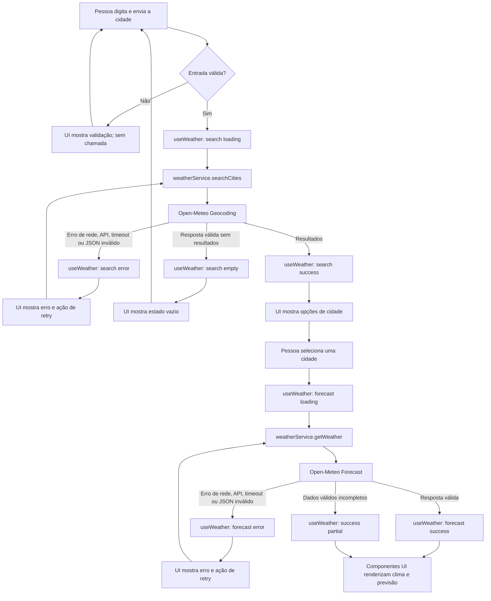

# Plano Técnico: Weather App

## Architecture

Aplicação SPA sem backend próprio. O navegador consulta diretamente os endpoints públicos da Open-Meteo, que não exigem API key. `App.tsx` compõe a tela; as responsabilidades seguem quatro camadas pequenas:

```text
components -> hooks -> services -> Open-Meteo
                   \-> lib (funções puras)
```

- **components:** recebem dados e estado por props, renderizam conteúdo e emitem ações por callbacks. Não fazem `fetch`, não controlam o fluxo da API e não convertem unidades.
- **hooks:** `useWeather` orquestra busca, seleção, consulta, retry, unidade e estados assíncronos. Expõe dados e handlers para a UI; depende do contrato `WeatherService`, não do formato JSON da Open-Meteo.
- **services:** `weatherService` é a única fronteira de acesso remoto. Encapsula URLs/parâmetros, timeout, validação de payload e mapeamento do JSON para `City`/`WeatherData`; não importa componentes React.
- **lib:** contém funções determinísticas sem efeitos colaterais para conversão de temperatura, formatação com timezone explícita e mapeamento de códigos WMO.
- **App.tsx:** compõe `SearchBar`, resultado selecionado, clima atual, previsão e estados; evita concentrar regras de negócio.
- Não criar backend, cache persistente, camada de repositório, estado global ou biblioteca de data fetching para este escopo.

## Tech Stack

- **Aplicação:** React 19 + TypeScript strict + Vite 8, conforme `package.json`.
- **Estilos:** Tailwind CSS 3.4, conforme configuração existente.
- **HTTP:** `fetch` nativo com `AbortController`; sem cliente HTTP adicional.
- **Testes:** Vitest + Testing Library para unidade/componentes; Playwright para fluxos E2E.
- **Qualidade:** Biome para lint e formatação.
- **Pacotes:** pnpm, conforme `packageManager` do projeto.
- **Dados:** Open-Meteo Geocoding API e Forecast API, sem segredo ou API key no cliente.

## Project Structure

Estrutura-alvo alinhada às convenções do repositório. No workspace atual, `src/` e `tests/` ainda não existem; deverão ser criadas na fase de implementação.

```text
src/
  App.tsx                    # composição da página
  components/                # apresentação e eventos de UI
    SearchBar.tsx
    CityResults.tsx
    CurrentWeather.tsx
    ForecastList.tsx
    ForecastCard.tsx
    UnitToggle.tsx
    states/
      EmptyState.tsx
      ErrorState.tsx
      LoadingState.tsx
  hooks/                     # orquestração e estado do fluxo
    useWeather.ts
  services/                  # I/O externo e adaptação do provedor
    weatherService.ts
  lib/                       # funções puras de domínio/apresentação
    format.ts
    temperature.ts
    weatherCodes.ts
  types/                     # contratos internos compartilhados
    weather.ts
  styles/
    index.css
```

Os testes ficam em `tests/`, fora de `src/`, conforme os scripts existentes: unitários por camada em `tests/unit/` e E2E em `tests/e2e/`. Manter o mapeamento e chamadas HTTP no único serviço; só dividir módulos se o serviço crescer ou os testes mostrarem uma fronteira necessária.

## Data Model

Os tipos internos não devem espelhar integralmente o JSON do provedor. Converter e validar a resposta na fronteira do serviço; valores meteorológicos ausentes são `null`, nunca zero implícito.

```ts
/** Unidade usada para apresentar as temperaturas. */
type Unit = 'celsius' | 'fahrenheit';

interface City {
  id: number; // Identificador da localidade retornado pelo Geocoding API.
  name: string; // Nome da cidade retornado pelo provedor.
  latitude: number; // Latitude usada para consultar a previsão.
  longitude: number; // Longitude usada para consultar a previsão.
  admin1: string | null; // Região administrativa, quando disponível.
  country: string | null; // País, quando disponível.
  timezone: string | null; // Fuso IANA do geocoding, quando retornado.
}

interface CurrentWeather {
  temperatureC: number | null; // Open-Meteo current.temperature_2m, normalizada para Celsius.
  weatherCode: number | null; // Código WMO de current.weather_code, localizado na apresentação.
  observedAt: string | null; // current.time retornado pela API, no fuso de WeatherData.timezone.
}

interface ForecastDay {
  date: string; // daily.time no formato YYYY-MM-DD e no fuso da cidade.
  weatherCode: number | null; // Código WMO de daily.weather_code.
  minTemperatureC: number | null; // daily.temperature_2m_min, normalizada para Celsius.
  maxTemperatureC: number | null; // daily.temperature_2m_max, normalizada para Celsius.
}

interface WeatherData {
  city: City; // Localidade selecionada pela pessoa usuária.
  timezone: string; // Fuso IANA retornado pelo Forecast API; fonte para datas e horários locais.
  current: CurrentWeather; // Condições atuais para a cidade.
  days: ForecastDay[]; // Cinco datas locais; campos ausentes permanecem null.
}

type WeatherErrorCode = 'timeout' | 'network' | 'http' | 'invalid-response';
type WeatherOperation = 'geocoding' | 'forecast';

interface WeatherServiceError {
  code: WeatherErrorCode;
  operation: WeatherOperation;
}

interface WeatherService {
  searchCities(query: string, signal?: AbortSignal): Promise<City[]>;
  getWeather(city: City, signal?: AbortSignal): Promise<WeatherData>;
}
```

**Regras de domínio:** resultados sem correspondência são lista vazia, não erro; previsão contém hoje + quatro datas seguintes na timezone retornada; Celsius é a unidade interna; Fahrenheit é derivada em apresentação pela fórmula `$F = (C × 9/5) + 32$`, arredondando ao inteiro mais próximo. Datas e horários são formatados com `Intl.DateTimeFormat('pt-BR', { timeZone })`.

## Data Flow

1. A pessoa digita a cidade e envia por Enter ou botão. Remover espaços externos; se restar vazio, mostrar validação local e não chamar serviço.
2. `useWeather` inicia busca e chama `searchCities` com o texto normalizado e timeout de 8 s.
3. O serviço consulta geocoding com `count=10`, idioma português, mapeia somente campos necessários e retorna até 10 opções.
4. Uma lista vazia vira estado `empty`. Resultados não são selecionados automaticamente; seleção da pessoa determina coordenadas da próxima consulta.
5. Ao selecionar, `useWeather` chama `getWeather` com latitude/longitude e inicia em Celsius.
6. O serviço solicita clima atual e forecast diário para cinco dias, timezone automática da localidade e unidade Celsius; mapeia a resposta para `WeatherData`.
7. A UI apresenta cidade, dados atuais, horário e cinco datas. `UnitToggle` altera somente a unidade de apresentação; não provoca nova chamada.
8. Em erro, manter a cidade e os parâmetros da operação para que “Tentar novamente” repita a mesma chamada. Não persistir seleção ou unidade após encerrar/recarregar a página.



## External APIs

### Geocoding

- **Método:** `GET`
- **URL base:** `https://geocoding-api.open-meteo.com/v1/search`
- **Parâmetros:** `name` é o texto normalizado; `count=10` limita os resultados; `language=pt` solicita nomes em português; `format=json` explicita o formato.
- **Exemplo de chamada:** `https://geocoding-api.open-meteo.com/v1/search?name=S%C3%A3o+Paulo&count=10&language=pt&format=json`
- **Resposta resumida:**

```json
{
  "results": [
    {
      "id": 3448439,
      "name": "São Paulo",
      "latitude": -23.55,
      "longitude": -46.63,
      "admin1": "São Paulo",
      "country": "Brasil",
      "timezone": "America/Sao_Paulo"
    }
  ]
}
```

- **Mapeamento para `City`:** `id`, `name`, `latitude`, `longitude`, `admin1`, `country` e `timezone` mapeiam diretamente. Se região, país ou timezone não vierem, usar `null`. Uma resposta válida sem `results` vira `[]`; erro HTTP ou JSON inválido continua sendo erro, não “cidade não encontrada”.

### Forecast

- **Método:** `GET`
- **URL base:** `https://api.open-meteo.com/v1/forecast`
- **Parâmetros:** `latitude` e `longitude` vêm da `City` selecionada; `current=temperature_2m,weather_code` solicita temperatura e código WMO atuais; `daily=weather_code,temperature_2m_min,temperature_2m_max` solicita condição e extremos diários; `forecast_days=5` solicita hoje e os quatro dias seguintes; `timezone=auto` usa o fuso da localidade; `temperature_unit=celsius` mantém Celsius como unidade canônica.
- **Exemplo de chamada:** `https://api.open-meteo.com/v1/forecast?latitude=-23.55&longitude=-46.63&current=temperature_2m%2Cweather_code&daily=weather_code%2Ctemperature_2m_min%2Ctemperature_2m_max&forecast_days=5&timezone=auto&temperature_unit=celsius`
- **Resposta resumida:**

```json
{
  "timezone": "America/Sao_Paulo",
  "current": {
    "time": "2026-10-29T12:00",
    "temperature_2m": 22.4,
    "weather_code": 3
  },
  "daily": {
    "time": ["2026-10-29", "2026-10-30", "2026-10-31", "2026-11-01", "2026-11-02"],
    "weather_code": [3, 2, 61, 0, 1],
    "temperature_2m_min": [18.1, 17.4, 19.0, 16.8, 17.2],
    "temperature_2m_max": [26.2, 25.0, 27.1, 24.5, 25.3]
  }
}
```

- **Mapeamento para `WeatherData`:** `timezone` da resposta é a timezone autoritativa. `current.temperature_2m` vira `current.temperatureC`; `current.weather_code` vira `current.weatherCode`; `current.time` vira `current.observedAt`, interpretado no fuso retornado. Para `daily`, percorrer os arrays pelo mesmo índice `i`: `time[i]` → `date`, `weather_code[i]` → `weatherCode`, `temperature_2m_min[i]` → `minTemperatureC` e `temperature_2m_max[i]` → `maxTemperatureC`. Não parear arrays por posição depois de remover um valor ausente; representar o campo correspondente como `null`. Mapear os códigos WMO para rótulos pt-BR na apresentação, sem alterar o código numérico no modelo.

Codificar query params com `URLSearchParams`. Validar status HTTP, estrutura JSON e arrays usados; HTTP 200 não garante resposta válida. Não enviar localização automática, dados de usuário ou segredo. Antes do lançamento, confirmar termos, atribuição, limites e cobertura conforme NFR-09.

## State Management

O estado de domínio vive em `useWeather`, local à tela; não usar Redux, Context global, URL state ou persistência. O texto ainda não enviado fica em estado local de `SearchBar`, pois não participa da consulta até o submit.

Manter estados assíncronos separados para geocoding e forecast, usando o mesmo contrato:

```ts
type AsyncState<T> =
  | { status: 'idle' }
  | { status: 'loading' }
  | { status: 'success'; data: T; partial?: boolean }
  | { status: 'empty' }
  | { status: 'error'; error: WeatherServiceError };

interface WeatherViewState {
  search: AsyncState<City[]>;
  forecast: AsyncState<WeatherData>;
  selectedCity: City | null;
  unit: Unit;
}
```

- **`idle`:** fluxo ainda não iniciado ou reiniciado por nova busca.
- **`loading`:** chamada correspondente está pendente. Busca e forecast podem carregar em momentos distintos.
- **`success`:** resposta válida com dados utilizáveis. Em forecast parcial, manter `success`, `partial: true` e os campos ausentes como `null`.
- **`empty`:** resposta de geocoding válida sem resultados; não representa falha HTTP nem se aplica a dados de forecast incompletos.
- **`error`:** falha de rede, HTTP, timeout ou formato inválido, com operação/código estruturados.

`selectedCity` é preenchida somente após escolha explícita. A unidade vive no hook, inicia em Celsius e reinicia em Celsius ao recarregar a página. Os valores do modelo permanecem em Celsius; durante a renderização, um helper puro recebe `temperatureC` e `unit`, converte para Fahrenheit quando necessário, arredonda ao inteiro mais próximo e formata com `Intl.NumberFormat('pt-BR')`. Não armazenar valores convertidos e não emitir requests ao alternar unidade.

O hook cancela requests superadas com `AbortController` e ignora respostas tardias. Retry manual repete a mesma operação com os mesmos parâmetros.

## Error Handling

- **Input inválido:** busca vazia é validada localmente, permanece no formulário e não muda o estado do serviço nem chama a API.
- **Geocoding sem resultados:** geocoding responde com sucesso e lista vazia; definir `search.status = 'empty'` e apresentar “Nenhuma cidade encontrada”.
- **Falha de rede:** rejeição de `fetch` vira erro `network`, vinculado a `geocoding` ou `forecast`; apresentar mensagem pt-BR e retry manual.
- **Erro da API:** resposta HTTP não-2xx vira erro `http`; não exibir detalhes internos ou tratar como ausência de cidade. Uma resposta 429 também segue esse fluxo, sem retry automático.
- **Timeout:** após 8 segundos, abortar a chamada e classificar como `timeout`; distinguir de cancelamento provocado por request mais recente, que é silencioso.
- **Resposta inválida:** JSON não parseável ou estrutura incompatível vira `invalid-response`; não renderizar payload inválido e oferecer retry.
- **Resposta parcial:** se a estrutura é válida, mas faltam valores meteorológicos, manter estado `success` com `partial: true`; renderizar dados disponíveis e “Indisponível” para cada campo ausente. Não preencher com zero, dado de outra data ou dado antigo.
- **Código WMO desconhecido:** manter o código/demais dados válidos e renderizar condição “Condição indisponível”.
- **Dados atuais acima de 3 h:** manter a resposta válida e mostrar indicação de desatualização, conforme limite proposto; não rotular como atuais.
- Não persistir cache entre sessões, implementar retry automático ou usar provedor alternativo sem decisão de produto.

## Testing Strategy

- **Vitest — `lib`:** cobrir temperaturas positivas, zero e negativas; conversão C/F; arredondamento ao inteiro mais próximo; formatação pt-BR com timezone fornecido; datas próximas à meia-noite/DST; códigos WMO conhecidos e desconhecidos. São testes puros, sem DOM, rede ou mocks.
- **Vitest — `services`:** usar `vi.stubGlobal('fetch', ...)` ou mock equivalente. Verificar URLs e parâmetros de geocoding/forecast, encoding de acentos, mapeamento para tipos internos, arrays alinhados por índice, resposta sem resultados, campos parciais, JSON inválido, HTTP não-2xx/429, rejeição de rede, timeout e abort. Nenhum teste unitário chama Open-Meteo real.
- **Vitest — `hooks`:** fornecer `WeatherService` mockado e testar transições de busca/forecast, seleção explícita, retry da mesma operação, resposta obsoleta/cancelada ignorada, unidade inicial Celsius e ausência de nova chamada ao alternar unidade.
- **Vitest + Testing Library — componentes:** testar estados `loading`, `error`, `empty` e `success` de forma isolada. Verificar mensagem e retry em erro, ausência de resultados, clima/previsão em sucesso, indisponibilidade para campos ausentes, busca vazia sem chamada, interação por teclado, labels e anúncio dos estados. Usar `user-event`; não testar detalhes internos de implementação.
- **Vitest — integração de `App`:** mockar apenas a fronteira `WeatherService` e percorrer busca, escolha de cidade, carregamento, clima, previsão e troca de unidade; confirmar que a conversão ocorre sem chamada adicional.
- **Playwright — E2E desktop:** interceptar com `page.route` as respostas de geocoding e forecast. Cobrir um fluxo principal de sucesso, cidade ambígua, nenhum resultado, erro seguido de retry e troca C/F sem nova requisição. Incluir ao menos um cenário de resposta parcial.
- **Playwright — viewport mobile:** executar o fluxo principal em viewport de 375 × 812 px e verificar busca, seleção, leitura dos cinco dias, troca de unidade, uso por teclado e ausência de rolagem horizontal (`scrollWidth <= clientWidth`). Validar também o layout em desktop de 1280 × 800 px.
- **Determinismo e limites:** mocks tornam o CI independente da disponibilidade externa. Um smoke test real da Open-Meteo, se aprovado, deve ser separado dos testes bloqueantes e não enviar dados pessoais.
- **Comandos de verificação:** `pnpm lint`, `pnpm build`, `pnpm test` e `pnpm test:e2e`. Playwright local não substitui monitoramento sintético, validação manual de leitor de tela nem medição de p95 em produção.

## Risks & Trade-offs

| Risco ou trade-off | Consequência | Mitigação/decisão |
|---|---|---|
| **API direta no navegador vs. backend/BFF** | A chamada direta simplifica deploy e não exige API key, mas acopla disponibilidade/latência ao provedor e não oferece cache ou fallback central. | Escolhida chamada direta para o MVP. Backend/BFF fica como alternativa se surgir necessidade de cache compartilhado, provedor alternativo, segredo ou controle de quota. |
| **Hook local vs. estado global ou biblioteca de data fetching** | Estado local é simples para uma única tela, mas não oferece cache, deduplicação ou retry automático. | Escolhido `useWeather` com `fetch` e `AbortController`; considerar React Query/SWR apenas se múltiplas telas ou cache/revalidação forem requisitos aprovados. Redux/Context global não se justifica no escopo atual. |
| **Celsius canônico vs. armazenar unidade convertida** | Guardar somente Celsius evita divergência entre unidades; o valor exibido depende de conversão e arredondamento na apresentação. | Escolhido Celsius canônico e conversão pura em renderização. Não fazer novo request nem armazenar os dois valores. |
| **Forecast diário vs. horário** | O diário reduz volume e complexidade, mas não atende decisões que dependam de variação intradiária. | Diário escolhido para o MVP; hourly permanece fora de escopo até validação de necessidade. |
| **Mocks no CI vs. chamadas reais em testes** | Mocks são estáveis e rápidos, mas não detectam sozinhos mudanças de contrato do provedor. | Usar mocks para testes bloqueantes; avaliar smoke test real separado, não bloqueante, com alerta para mudanças de contrato. |
| **Sem persistência vs. salvar preferências localmente** | Não salvar cidade/unidade reduz retenção, mas a preferência volta a Celsius ao reabrir a página. | Não persistir no MVP; armazenamento local só após decisão explícita de produto/privacidade. |
| **Metas operacionais propostas** | Timeout, freshness e disponibilidade podem não corresponder ao serviço ou à expectativa do público. | Aprovar e validar as metas com sondas/telemetria antes de tratá-las como SLO de produção. |

**Decisões que bloqueiam o plano de tarefas:** aprovar canal e navegadores, regiões/idiomas prioritários, campos do MVP, thresholds NFR, termos/limites/atribuição do provedor e política de logs. O plano não presume aprovação dessas propostas.